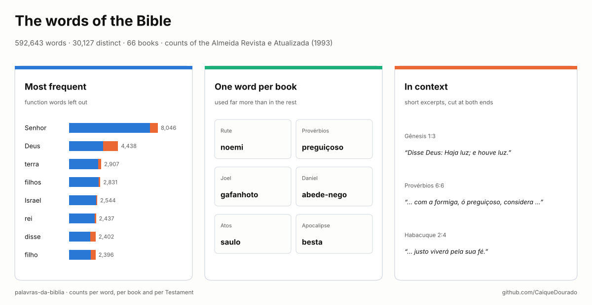
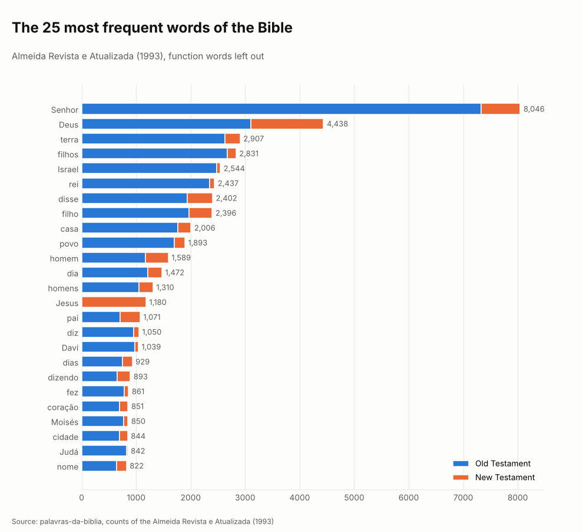
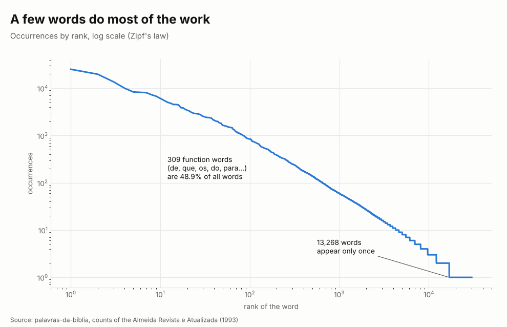
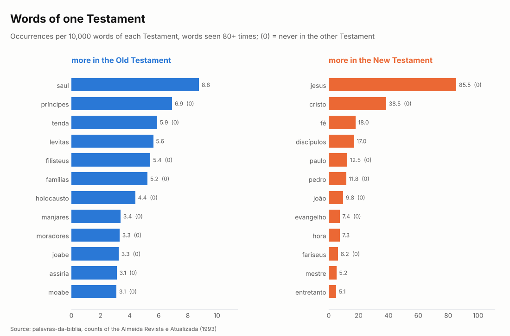
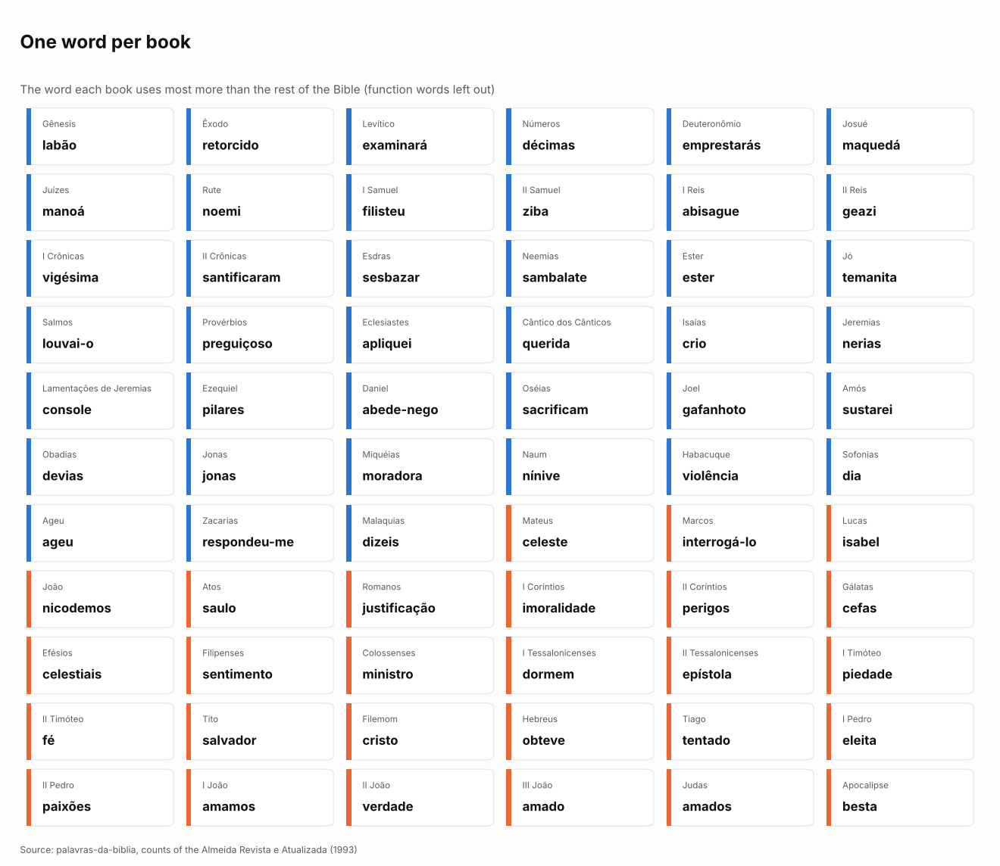
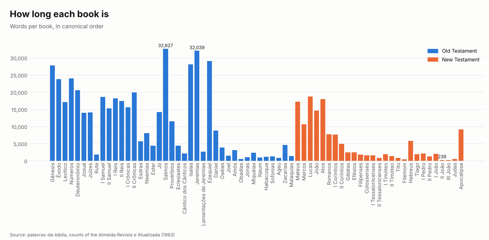
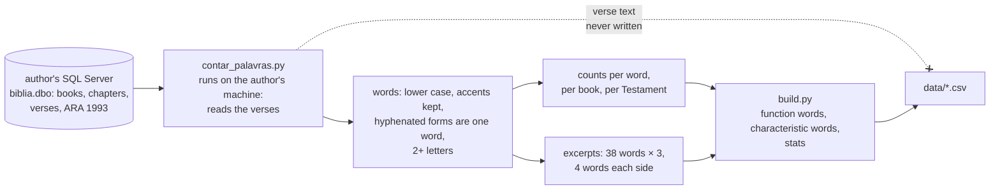

# Palavras da Bíblia · Words of the Bible (Portuguese)

[](https://github.com/CaiqueDourado/palavras-da-biblia/actions/workflows/validate.yml)
[](LICENSE-DATA.md)
[](LICENSE)
[](https://www.kaggle.com/datasets/caiquedourado/palavras-da-biblia)

[Leia em português](README.pt-BR.md)



Every word of the Portuguese Bible in the **Almeida Revista e Atualizada (1993)** translation, counted:
**592,643 words, 30,127 distinct**, in 66 books, 1,189 chapters and 31,104 verses. For each word: how many
times it appears, in how many verses, chapters and books, and how often in each Testament. Also the count
of every word in every book, the words that characterise each book, and 114 short excerpts that show some
of them in context.

The translation is protected by copyright, so **the text itself is not here**: only counts, and excerpts
of a few words each, quoted with their reference.

## The page this comes from

From 2022 the author ran **versiculo-do-dia.com**, a site with a page for every book, chapter and verse of
the Bible, an image of each verse for social media and a page called **"Palavras que mais aparecem na
Bíblia"** (the words that appear most in the Bible), with one page per word. This dataset is that word
index, rebuilt from the same database and studied.


| On the site | In this dataset |
|---|---|
| "Palavras que mais aparecem na Bíblia", one page per word | `palavras.csv`: occurrences, verses, chapters, books, Old and New Testament |
| Pages per book and chapter | `livros.csv`: chapters, verses, words and vocabulary of each book; `palavras_por_livro.csv` |
| "Verses that contain the word X" | `contextos.csv`: up to 3 short excerpts for 38 words, with the reference |
| Verse text and images | not published (protected translation) |

## What the counts show

### The most frequent words



Leaving out function words, **Senhor** (Lord) leads with 8,046 occurrences, almost twice **Deus** (God,
4,438). Senhor is an Old Testament word: 7,327 of its occurrences are there, where it renders God's name.
**Jesus** (1,180) appears only in the New Testament, and is still the 14th word of the chart.

### Half of the text is 309 words



The 309 function words (de, que, os, do, para…) are **48.9% of everything written**, and the 100 most
frequent words alone are 48.4%. At the other end, **13,268 words appear only once**: 44% of the vocabulary.
Among them are the longest "words" of the translation, names translated with hyphens, such as
*rápido-despojo-presa-segura* (Isaiah) and *terror-por-todos-os-lados* (Jeremiah).

### Words of one Testament



The Old Testament has 454,624 words and the New 138,019, so the chart compares rates, not counts. Princes,
tents, Philistines and burnt offerings never reach the New Testament; Jesus, Christ, Paul, Peter, the
gospel and the Pharisees never appear in the Old. A few words change sides almost completely:

| Word | Old Testament | New Testament | |
|---|---:|---:|---|
| **fé** (faith) | 1 | 248 | the only one in the Old Testament: "… justo viverá pela sua fé." (Habakkuk 2:4) |
| **graça** (grace) | 49 | 141 | "Porém Noé achou graça diante do Senhor." (Genesis 6:8) |
| **amor** (love) | 132 | 136 | 2.9 per 10,000 words in the Old, 9.9 in the New |
| **besta** (beast) | 1 | 37 | 37 in Revelation: "… marca, o nome da besta ou o número do …" (Revelation 13:17) |

### One word per book



For each book, the word it uses far more than the other 65 (the log of its rate in the book over its rate
in the rest). The result is a quick map of the Bible: **noemi** in Ruth, **preguiçoso** (the sluggard) in
Proverbs, **gafanhoto** (the locust) in Joel, **abede-nego** in Daniel, **saulo** in Acts, **besta** in
Revelation, **filhinhos** (little children) among the five most characteristic of 1 John. The top 5 of
each book are in `palavras_caracteristicas.csv`.

> "… com a formiga, ó preguiçoso, considera os seus caminhos …" (Proverbs 6:6)

### The size of each book



Psalms is the longest book (32,627 words, and the largest vocabulary, 5,376 distinct words), just ahead of
Jeremiah (32,039). 2 John is the shortest: 239 words.

## Files

All in [`data/`](data), on GitHub and on [Kaggle](https://www.kaggle.com/datasets/caiquedourado/palavras-da-biblia).

| File | Rows | What |
|---|---:|---|
| `palavras.csv` | 30,127 | word, occurrences, verses, chapters, books, occurrences in the Old and New Testament, first book, `funcional` (function word) |
| `palavras_por_livro.csv` | 115,717 | book × word occurrences (only pairs that occur) |
| `livros.csv` | 66 | order, book, Testament, chapters, verses, words, distinct words |
| `palavras_caracteristicas.csv` | 323 | up to 5 characteristic words per book, with the index (short books have fewer words seen 4+ times) |
| `contextos.csv` | 114 | word, reference, excerpt (at most 4 words on each side of the word) |
| `stats.json` | | totals |

```python
import pandas as pd

words = pd.read_csv("data/palavras.csv", keep_default_na=False)   # keep_default_na: "nan" is not a word here
words[~words.funcional].head(20)                                   # most frequent, without function words

by_book = pd.read_csv("data/palavras_por_livro.csv", keep_default_na=False)
by_book.query("palavra == 'amor'").sort_values("ocorrencias", ascending=False).head(10)
```

The [notebook](notebooks/estudo.ipynb) has the whole study.

## How it was made



- **Words.** Lower case, accents kept, punctuation removed. Forms with a hyphen stay one word (*louvai-o*,
  *disse-lhes*), as in the translation. One-letter words (*e*, *a*, *o*) are left out, as on the site.
- **Function words** are a list of 309 articles, prepositions, pronouns, conjunctions and forms of *ser*,
  *estar*, *ter* and *haver* ([scripts/stopwords.py](scripts/stopwords.py)). They stay in every file,
  flagged in `funcional`.
- **Characteristic words** use the log2 of a word's rate in the book over its rate in the rest of the
  Bible, with 0.5 added to both counts, for words seen at least 4 times in the book.
- **Excerpts** are cut at both ends, at most 4 words on each side of the word, at most 3 per word, from
  different parts of the Bible; the validation in CI checks those limits.

## Limits

- One translation. Other editions (Almeida Corrigida Fiel, NVI, NAA) use other words and other counts.
- Capital letters are lost: *Senhor* (the Lord) and *senhor* (sir, master) are counted together, as are
  names and common words with the same spelling.
- The site counted words with a database index and one-letter words left out; small differences from its
  pages are expected.
- The function-word list is a choice; the column `funcional` lets you use another.

## License

The counts, flags and indexes are **CC BY 4.0** ([LICENSE-DATA.md](LICENSE-DATA.md)); the code is MIT.
The excerpts in `contextos.csv` are short quotations of the *Almeida Revista e Atualizada*, 2nd edition,
© 1993 Sociedade Bíblica do Brasil, used for study with their reference; they are not covered by the CC
license. Removal requests: open an issue.

## Author

**Caique Dourado**: 20 years building crawlers, data pipelines and programmatic SEO in .NET and SQL Server. More at [github.com/CaiqueDourado](https://github.com/CaiqueDourado).
