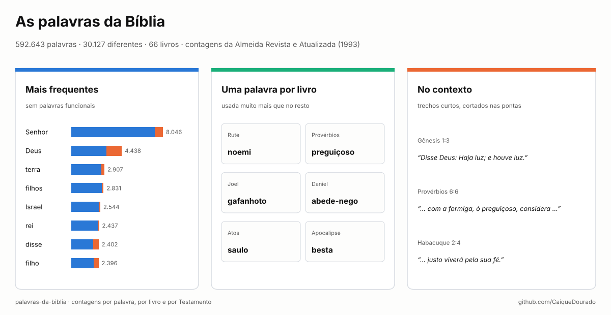
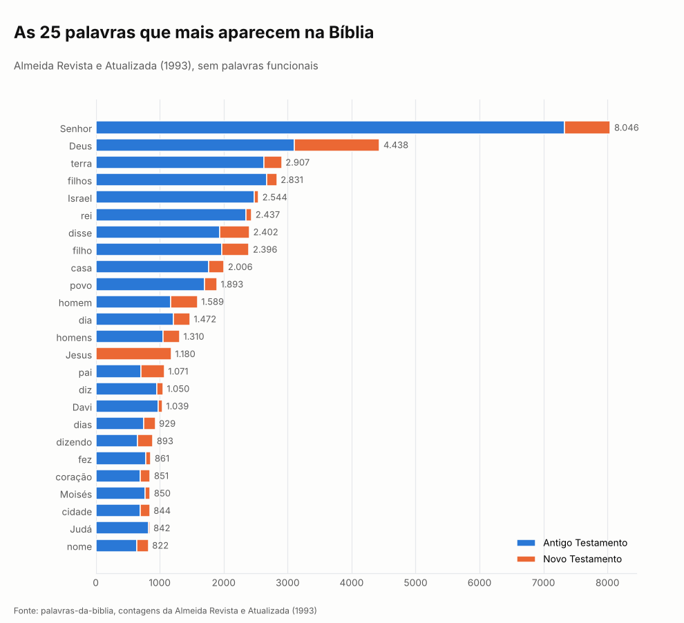
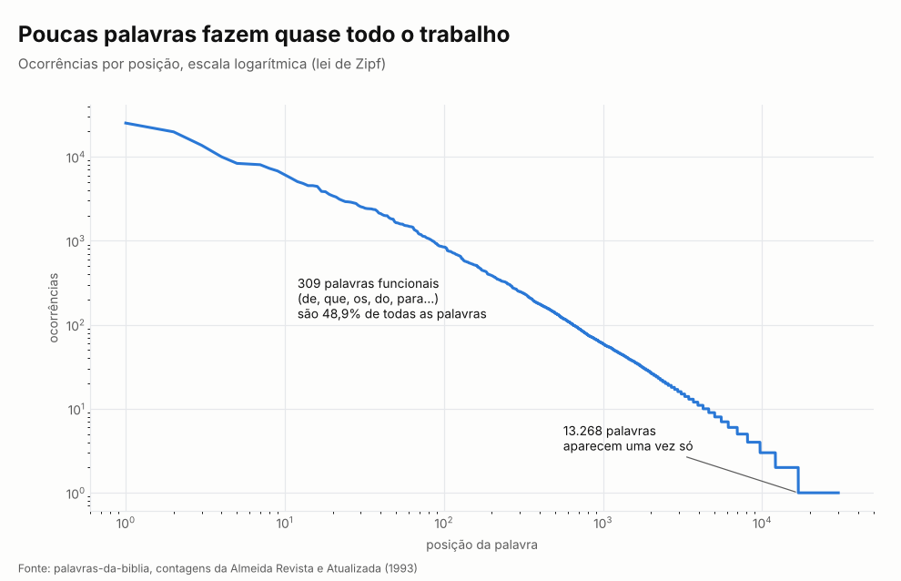
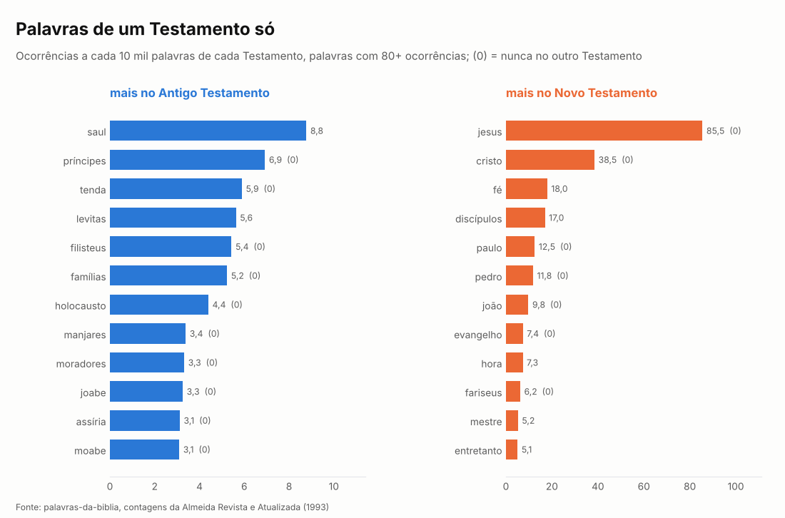
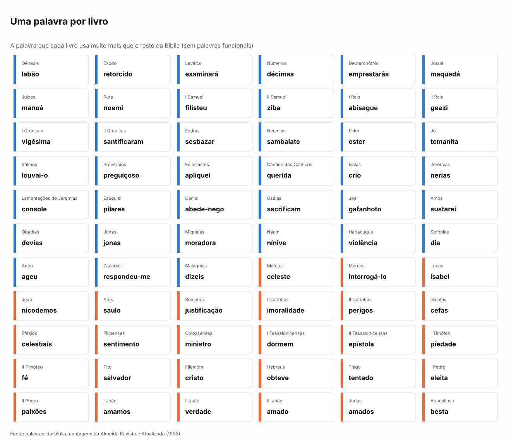
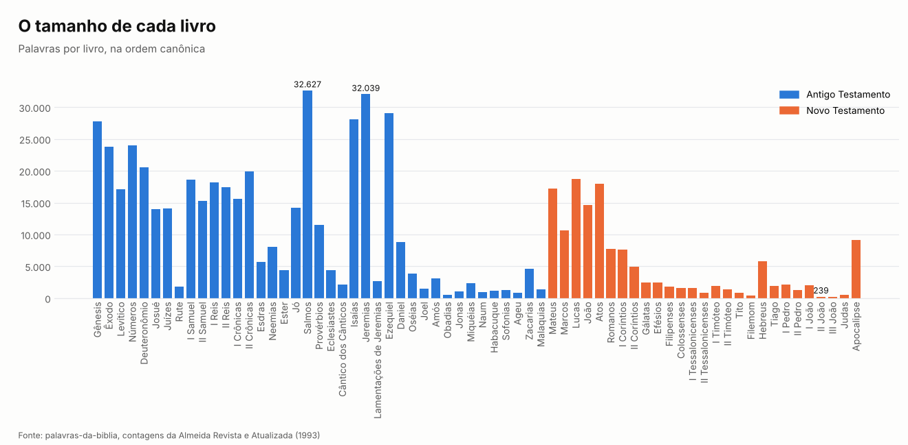
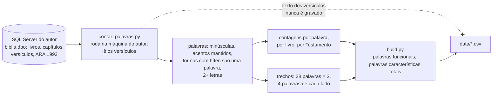

# Palavras da Bíblia

[](https://github.com/CaiqueDourado/palavras-da-biblia/actions/workflows/validate.yml)
[](LICENSE-DATA.md)
[](LICENSE)
[](https://www.kaggle.com/datasets/caiquedourado/palavras-da-biblia)

[Read in English](README.md)



Todas as palavras da Bíblia na tradução **Almeida Revista e Atualizada (1993)**, contadas: **592.643
palavras, 30.127 diferentes**, em 66 livros, 1.189 capítulos e 31.104 versículos. Para cada palavra:
quantas vezes aparece, em quantos versículos, capítulos e livros, e quantas vezes em cada Testamento.
Também a contagem de cada palavra em cada livro, as palavras que caracterizam cada livro e 114 trechos
curtos que mostram algumas delas no contexto.

A tradução tem direito autoral, então **o texto não está aqui**: só contagens e trechos de poucas palavras,
citados com a referência.

## A página de onde isto vem

Desde 2022 o autor mantém o **versiculo-do-dia.com**, um site com uma página para cada livro, capítulo e
versículo da Bíblia, uma imagem de cada versículo para redes sociais e uma página chamada **"Palavras que
mais aparecem na Bíblia"**, com uma página por palavra. Este dataset é esse índice de palavras, refeito a
partir do mesmo banco e estudado.


| No site | Neste dataset |
|---|---|
| "Palavras que mais aparecem na Bíblia", uma página por palavra | `palavras.csv`: ocorrências, versículos, capítulos, livros, Antigo e Novo Testamento |
| Páginas por livro e capítulo | `livros.csv`: capítulos, versículos, palavras e vocabulário de cada livro; `palavras_por_livro.csv` |
| "Versículos que têm a palavra X" | `contextos.csv`: até 3 trechos curtos para 38 palavras, com a referência |
| Texto dos versículos e imagens | não publicado (tradução protegida) |

## O que as contagens mostram

### As palavras mais frequentes



Sem as palavras funcionais, **Senhor** lidera com 8.046 ocorrências, quase o dobro de **Deus** (4.438).
Senhor é palavra do Antigo Testamento: 7.327 das ocorrências estão lá, onde traduz o nome de Deus.
**Jesus** (1.180) só aparece no Novo Testamento, e mesmo assim é a 14ª palavra do gráfico.

### Metade do texto são 309 palavras



As 309 palavras funcionais (de, que, os, do, para…) são **48,9% de tudo o que está escrito**, e só as 100
palavras mais frequentes são 48,4%. Na outra ponta, **13.268 palavras aparecem uma vez só**: 44% do
vocabulário. Entre elas estão as "palavras" mais longas da tradução, nomes traduzidos com hífens, como
*rápido-despojo-presa-segura* (Isaías) e *terror-por-todos-os-lados* (Jeremias).

### Palavras de um Testamento só



O Antigo Testamento tem 454.624 palavras e o Novo, 138.019, então o gráfico compara taxas, não contagens.
Príncipes, tendas, filisteus e holocaustos não chegam ao Novo Testamento; Jesus, Cristo, Paulo, Pedro, o
evangelho e os fariseus não aparecem no Antigo. Algumas palavras mudam de lado quase por completo:

| Palavra | Antigo Testamento | Novo Testamento | |
|---|---:|---:|---|
| **fé** | 1 | 248 | a única do Antigo Testamento: "… justo viverá pela sua fé." (Habacuque 2:4) |
| **graça** | 49 | 141 | "Porém Noé achou graça diante do Senhor." (Gênesis 6:8) |
| **amor** | 132 | 136 | 2,9 a cada 10 mil palavras no Antigo, 9,9 no Novo |
| **besta** | 1 | 37 | as 37 no Apocalipse: "… marca, o nome da besta ou o número do …" (Apocalipse 13:17) |

### Uma palavra por livro



Para cada livro, a palavra que ele usa muito mais que os outros 65 (o log da taxa no livro sobre a taxa no
resto). O resultado é um mapa rápido da Bíblia: **noemi** em Rute, **preguiçoso** em Provérbios,
**gafanhoto** em Joel, **abede-nego** em Daniel, **saulo** em Atos, **besta** no Apocalipse, **filhinhos**
entre as cinco mais características de I João. As 5 primeiras de cada livro estão em
`palavras_caracteristicas.csv`.

> "… com a formiga, ó preguiçoso, considera os seus caminhos …" (Provérbios 6:6)

### O tamanho de cada livro



Salmos é o livro mais longo (32.627 palavras e o maior vocabulário, 5.376 palavras diferentes), logo à
frente de Jeremias (32.039). II João é o mais curto: 239 palavras.

## Arquivos

Todos em [`data/`](data), no GitHub e no [Kaggle](https://www.kaggle.com/datasets/caiquedourado/palavras-da-biblia).

| Arquivo | Linhas | O que tem |
|---|---:|---|
| `palavras.csv` | 30.127 | palavra, ocorrências, versículos, capítulos, livros, ocorrências no Antigo e no Novo Testamento, primeiro livro, `funcional` (palavra funcional) |
| `palavras_por_livro.csv` | 115.717 | ocorrências de cada palavra em cada livro (só os pares que existem) |
| `livros.csv` | 66 | ordem, livro, Testamento, capítulos, versículos, palavras, palavras diferentes |
| `palavras_caracteristicas.csv` | 323 | até 5 palavras características por livro, com o índice (livros curtos têm menos palavras vistas 4+ vezes) |
| `contextos.csv` | 114 | palavra, referência, trecho (no máximo 4 palavras de cada lado da palavra) |
| `stats.json` | | totais |

```python
import pandas as pd

palavras = pd.read_csv("data/palavras.csv", keep_default_na=False)   # keep_default_na: "nan" não é palavra aqui
palavras[~palavras.funcional].head(20)                                # as mais frequentes, sem funcionais

por_livro = pd.read_csv("data/palavras_por_livro.csv", keep_default_na=False)
por_livro.query("palavra == 'amor'").sort_values("ocorrencias", ascending=False).head(10)
```

O [notebook](notebooks/estudo.ipynb) tem o estudo inteiro.

## Como foi feito



- **Origem dos versículos.** O banco do site foi carregado a partir de
  [A Bíblia em SQL (MySQL) em 13 versões](https://www.sydney.eti.br/a-biblia-em-sql-mysql-em-13-versoes/), de Sydney Machado (2020), um dump MySQL de 13 traduções
  em português e inglês; este estudo usa a *Almeida Revista e Atualizada* (1993) dele. Quem quiser o
  texto pode começar por lá; a página não informa licença, então confira os direitos de cada tradução antes
  de usar.
- **Palavras.** Minúsculas, acentos mantidos, pontuação removida. Formas com hífen ficam como uma palavra
  (*louvai-o*, *disse-lhes*), como na tradução. Palavras de uma letra (*e*, *a*, *o*) ficam de fora, como no
  site.
- **Palavras funcionais** são uma lista de 309 artigos, preposições, pronomes, conjunções e formas de *ser*,
  *estar*, *ter* e *haver* ([scripts/stopwords.py](scripts/stopwords.py)). Elas continuam em todos os
  arquivos, marcadas em `funcional`.
- **Palavras características** usam o log2 da taxa da palavra no livro sobre a taxa no resto da Bíblia,
  com 0,5 somado às duas contagens, para palavras vistas pelo menos 4 vezes no livro.
- **Trechos** são cortados nas duas pontas, no máximo 4 palavras de cada lado da palavra, no máximo 3 por
  palavra, de partes diferentes da Bíblia; a validação no CI confere esses limites.

## Limites

- Uma tradução só. Outras edições (Almeida Corrigida Fiel, NVI, NAA) usam outras palavras e dão outras
  contagens.
- As maiúsculas se perdem: *Senhor* (Deus) e *senhor* (dono, patrão) são contados juntos, assim como nomes
  e palavras comuns com a mesma grafia.
- O site contava as palavras com um índice no banco e sem as palavras de uma letra; pequenas diferenças em
  relação às páginas dele são esperadas.
- A lista de palavras funcionais é uma escolha; a coluna `funcional` permite usar outra.

## Licença

As contagens, marcações e índices são **CC BY 4.0** ([LICENSE-DATA.md](LICENSE-DATA.md)); o código é MIT.
Os trechos em `contextos.csv` são citações curtas da *Almeida Revista e Atualizada*, 2ª edição, © 1993
Sociedade Bíblica do Brasil, usadas para estudo com a referência; elas não estão sob a licença CC. Pedidos
de remoção: abra uma issue.

## Autor

**Caique Dourado**: 20 anos construindo crawlers, pipelines de dados e SEO programático em .NET e SQL Server. Mais em [github.com/CaiqueDourado](https://github.com/CaiqueDourado).
